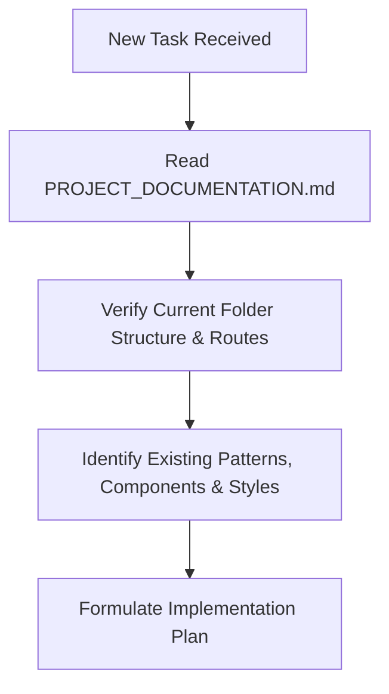
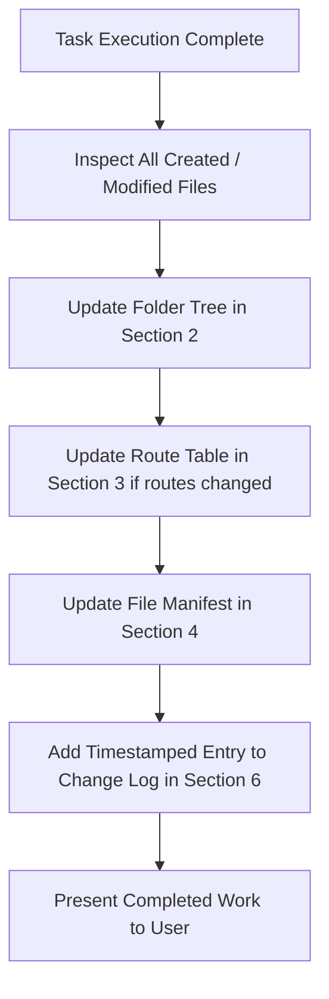

# RIS Project Documentation & Living Architecture Blueprint

> **CRITICAL AGENT PROTOCOL**:
> 1. **MANDATORY PRE-TASK CHECK**: Before starting any new task, feature, page, component, or code modification, you **MUST read this document first** to understand the current folder structure, routing table, existing components, and project conventions.
> 2. **MANDATORY POST-TASK SYNC**: At the conclusion of **EVERY** task where files/content are created, modified, or returned, you **MUST update this document** immediately to reflect the latest folder structure, updated/new file descriptions, routing changes, and append a record to the [Change Log](#change-log).

---

## 1. Project Overview

- **Project Name**: RIS (Radiology Information System / Web Application)
- **Primary Framework**: Next.js 16.4.0 (App Router) with React 19.3.0
- **Language**: TypeScript 5 (Strict mode)
- **Styling**: Tailwind CSS v4 (`@tailwindcss/turbopack`)
- **Bundler / Compiler**: Next.js Turbopack with inline theme configuration
- **Code Quality**: ESLint 9 (Flat config), Prettier 3.9, Husky pre-commit git hooks
- **Repository Layout**: Project structure with `frontend/` containing the primary Next.js web application and root configuration.

---

## 2. Complete Folder Structure

Below is the verified, up-to-date workspace directory tree:

```text
/RIS/
├── .vscode/                                # VS Code workspace preferences
│   └── settings.json                       # Workspace Git ignore limit configuration
├── frontend/                               # Next.js web application root
│   ├── .husky/                             # Git pre-commit automation hooks
│   │   └── pre-commit                      # Runs Prettier format & ESLint before commit
│   ├── app/                                # Next.js 16 App Router directory
│   │   ├── favicon.ico                     # Standard browser tab favicon
│   │   ├── globals.css                     # Global styles, Tailwind v4 imports & CSS variables
│   │   ├── layout.tsx                      # Root HTML layout with Geist font definition
│   │   └── page.tsx                        # Root homepage landing view (Route: /)
│   ├── public/                             # Public static assets (images, icons, SVGs)
│   ├── types/                              # Shared custom TypeScript definitions & interfaces
│   ├── .gitignore                          # Git ignore list for frontend dependencies & build outputs
│   ├── .prettierignore                     # Files excluded from Prettier formatting
│   ├── .prettierrc                         # Prettier code formatting rules
│   ├── AGENTS.md                           # Next.js 16 agent rules & doc sync reminder
│   ├── eslint.config.mjs                   # ESLint 9 flat configuration with Next.js rules
│   ├── next-env.d.ts                       # Next.js ambient TypeScript declaration
│   ├── next.config.ts                      # Next.js 16 config with Turbopack CSS rules
│   ├── package.json                        # Dependencies, scripts, and package metadata
│   ├── package-lock.json                   # Deterministic dependency lockfile
│   ├── README.md                           # Standard Next.js getting started guide
│   └── tsconfig.json                       # TypeScript compiler options & `@/*` path aliases
```

---

## 3. File Routing & Navigation Architecture

The web application uses the **Next.js 16 App Router**. All routes reside within `frontend/app/`.

### Current Route Map

| URL Path | File Location | Route Type | Description & Purpose |
| :--- | :--- | :--- | :--- |
| `/` | `frontend/app/page.tsx` | Server/Client Page | Default root landing page. Currently serves the initial homepage view. |
| *(Layout)* | `frontend/app/layout.tsx` | Root Layout | Global shell wrapping all routes; injects Geist Sans/Mono fonts and `globals.css`. |

### Route Creation Conventions

1. **New Pages**: Create a folder under `frontend/app/<route-name>/page.tsx`.
2. **Nested Routes**: Create subfolders, e.g., `frontend/app/<section>/<subpage>/page.tsx`.
3. **Dynamic Routes**: Use bracket syntax, e.g., `frontend/app/patients/[id]/page.tsx`.
4. **API Endpoints**: Place route handlers inside `frontend/app/api/<endpoint>/route.ts`.
5. **Route Groups & Modals**: Use parentheses for logical grouping (e.g., `app/(dashboard)/layout.tsx`) without affecting URL path.

> **CRITICAL**: Every time a new route or page is created or modified, update the **Current Route Map** table above immediately!

---

## 4. File Manifest & Content Summary

Detailed description of core project files and their operational purpose:

### Root Level
- **[PROJECT_DOCUMENTATION.md]**: Master living document. Tracks architecture, folder structure, routing, content, and the history of changes.
- **[AGENTS.md]**: Workspace agent rules. Enforces mandatory pre-task inspection of `PROJECT_DOCUMENTATION.md` and mandatory post-task documentation updates.
- **[skills-lock.json]**: Tracks external and local agent skills installed in `.agents/skills`.

### Frontend Core Configuration
- **[package.json]**:
  - Runtime: Next.js `16.4.0`, React `19.3.0`, React DOM `19.3.0`.
  - Dev tools: Tailwind CSS `^4`, `@tailwindcss/turbopack` `^4`, TypeScript `^5`, ESLint `^9`, Prettier `^3.9.10`, Husky `^9.1.7`.
  - Scripts:
    - `npm run dev`: Starts Turbopack development server.
    - `npm run build`: Compiles production bundle.
    - `npm run lint`: Executes ESLint checks.
    - `npm run format`: Formats code with Prettier.
    - `npm run format:check`: Validates Prettier compliance without writing.
- **[tsconfig.json]**: Configured with `@/*` path mapping to `./*` (resolves relative to `frontend/`), strict type checking, and ES2017+ target.
- **[next.config.ts]**: Configures Turbopack loaders for Tailwind CSS v4 (`@tailwindcss/turbopack`), experimental agent feedback, component caching, and partial prefetching.
- **[.husky/pre-commit]**: Pre-commit hook that automatically runs Prettier formatting, re-stages changed files, and runs ESLint before any git commit.

### Frontend Application Structure (`frontend/app/`)
- **[app/layout.tsx]**:
  - Root layout component configuring Google Fonts (`Geist` and `Geist Mono`).
  - Sets root `html` and `body` classes with full height antialiasing.
  - Injects `globals.css`.
- **[app/globals.css](file:///d:/RIS/frontend/app/globals.css)**:
  - Imports Tailwind CSS v4 (`@import "tailwindcss";`).
  - Configures CSS variables for light/dark mode backgrounds (`#ffffff` / `#0a0a0a`) and foregrounds (`#171717` / `#ededed`).
  - Defines `@theme inline` mapping `--color-background`, `--color-foreground`, `--font-sans`, and `--font-mono`.
- **[app/page.tsx](file:///d:/RIS/frontend/app/page.tsx)**:
  - Main landing view component for route `/`.
- **[types/](file:///d:/RIS/frontend/types)**:
  - Dedicated folder for application TypeScript interfaces, DTOs, and component prop definitions.

---

## 5. Living Documentation Sync Protocol

Every AI agent and developer working on this codebase must adhere strictly to the following 3-phase lifecycle:

### Phase 1: Pre-Execution Inspection

1. Always read `PROJECT_DOCUMENTATION.md` before generating or modifying any code.
2. Confirm existing file paths, route structures, and components to prevent duplicate work or broken paths.

### Phase 2: Active Implementation
1. Adhere to React 19 and Next.js 16 conventions (App Router, Server Components by default, Client Components only when interactive).
2. Use Tailwind CSS v4 utility classes and existing CSS variables.
3. Keep track of all files created, modified, moved, or deleted.

### Phase 3: Post-Execution Documentation Sync

1. **Update Folder Tree**: Reflect any added, deleted, or renamed directories and files.
2. **Update Route Table**: Add new URL endpoints, parameters, or page descriptions.
3. **Update File Manifest**: Document new components, services, types, or utilities.
4. **Append Change Log**: Add an entry under Section 6 with date, description of changes, files touched, and next steps.

---

## 6. Change Log
