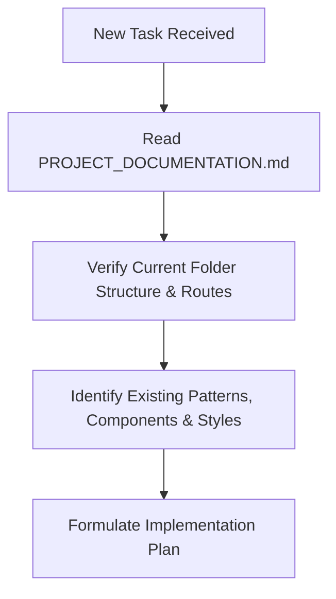
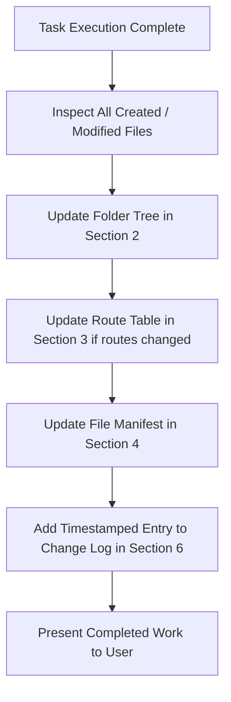

# RIS Project Documentation & Living Architecture Blueprint

> **CRITICAL AGENT PROTOCOL**:
> 1. **MANDATORY PRE-TASK CHECK**: Before starting any new task, feature, page, component, or code modification, you **MUST read this document first** to understand the current folder structure, routing table, existing components, and project conventions.
> 2. **MANDATORY POST-TASK SYNC**: At the conclusion of **EVERY** task where files/content are created, modified, or returned, you **MUST update this document** immediately to reflect the latest folder structure, updated/new file descriptions, routing changes, and append a record to the [Change Log](#change-log).

---

## 1. Project Overview

- **Project Name**: RIS (Radiology Information System / Web Application)
- **Primary Framework**: Next.js 16.4.0 (App Router) with React 19.3.0
- **Language**: TypeScript 5 (Strict mode)
- **Styling**: Tailwind CSS v4 (`@tailwindcss/turbopack`)
- **Bundler / Compiler**: Next.js Turbopack with inline theme configuration
- **Code Quality**: ESLint 9 (Flat config), Prettier 3.9, Husky pre-commit git hooks
- **Repository Layout**: Project structure with `frontend/` containing the primary Next.js web application and root configuration.

---

## 2. Complete Folder Structure

Below is the verified, up-to-date workspace directory tree:

```text
/RIS/
├── .husky/                                 # Git automation hooks (active at root)
│   └── pre-commit                          # Pre-commit hook script with POSIX shebang & npm --prefix frontend
├── .vscode/                                # VS Code workspace preferences
│   └── settings.json                       # Workspace Git ignore limit configuration
├── frontend/                               # Next.js web application root
│   ├── .husky/                             # Frontend-local husky assets
│   │   └── pre-commit                      # Secondary hook reference
│   ├── app/                                # Next.js 16 App Router directory
│   │   ├── favicon.ico                     # Standard browser tab favicon
│   │   ├── globals.css                     # Global styles, Tailwind v4 imports & CSS variables
│   │   ├── layout.tsx                      # Root HTML layout integrating Navbar, Footer & Google Font Poppins
│   │   └── page.tsx                        # Root homepage landing view (Route: /) with section anchors
│   ├── components/                         # Reusable UI and application components
│   │   └── common/                         # Common shared layouts & navigation
│   │       ├── Footer.tsx                  # Responsive global site footer
│   │       └── Navbar.tsx                  # Fully responsive top navigation bar & mobile drawer
│   ├── constants/                          # Shared constants & design tokens
│   │   └── colour.tsx                      # Brand palette color constants (cream, primaryDark, accent, secondary)
│   ├── data/                               # Application datasets and navigation configuration
│   │   ├── footerData.ts                   # Structured configuration for footer content, links & contacts
│   │   ├── navbarData.ts                   # Navigation menu items configuration and interface
│   │   └── socialMediaData.ts              # Social media profile links, platforms, and metadata
│   ├── public/                             # Public static assets (images, icons, SVGs)
│   ├── types/                              # Shared custom TypeScript definitions & interfaces
│   ├── .gitignore                          # Git ignore list for frontend dependencies & build outputs
│   ├── .prettierignore                     # Files excluded from Prettier formatting
│   ├── .prettierrc                         # Prettier code formatting rules
│   ├── AGENTS.md                           # Next.js 16 agent rules & doc sync reminder
│   ├── eslint.config.mjs                   # ESLint 9 flat configuration with Next.js rules
│   ├── next-env.d.ts                       # Next.js ambient TypeScript declaration
│   ├── next.config.ts                      # Next.js 16 config with Turbopack CSS rules
│   ├── package.json                        # Dependencies, scripts, and package metadata
│   ├── package-lock.json                   # Deterministic dependency lockfile
│   ├── README.md                           # Standard Next.js getting started guide
│   └── tsconfig.json                       # TypeScript compiler options & `@/*` path aliases
├── package.json                            # Root workspace orchestration script proxies (dev, lint, format)
└── skills-lock.json                        # Installed agent skill lock definitions
```

---

## 3. File Routing & Navigation Architecture

The web application uses the **Next.js 16 App Router**. All routes reside within `frontend/app/`.

### Current Route Map

| URL Path | File Location | Route Type | Description & Purpose |
| :--- | :--- | :--- | :--- |
| `/` | `frontend/app/page.tsx` | Server/Client Page | Default root landing page. Currently serves the initial homepage view. |
| *(Layout)* | `frontend/app/layout.tsx` | Root Layout | Global shell wrapping all routes; injects Geist Sans/Mono fonts and `globals.css`. |

### Route Creation Conventions

1. **New Pages**: Create a folder under `frontend/app/<route-name>/page.tsx`.
2. **Nested Routes**: Create subfolders, e.g., `frontend/app/<section>/<subpage>/page.tsx`.
3. **Dynamic Routes**: Use bracket syntax, e.g., `frontend/app/patients/[id]/page.tsx`.
4. **API Endpoints**: Place route handlers inside `frontend/app/api/<endpoint>/route.ts`.
5. **Route Groups & Modals**: Use parentheses for logical grouping (e.g., `app/(dashboard)/layout.tsx`) without affecting URL path.

> **CRITICAL**: Every time a new route or page is created or modified, update the **Current Route Map** table above immediately!

---

## 4. File Manifest & Content Summary

Detailed description of core project files and their operational purpose:

### Root Level
- **[PROJECT_DOCUMENTATION.md]**: Master living document. Tracks architecture, folder structure, routing, content, and the history of changes.
- **[AGENTS.md]**: Workspace agent rules. Enforces mandatory pre-task inspection of `PROJECT_DOCUMENTATION.md` and mandatory post-task documentation updates.
- **[skills-lock.json]**: Tracks external and local agent skills installed in `.agents/skills`.

### Root Workspace Configuration
- **[.husky/pre-commit]**: Root Git pre-commit hook with POSIX shebang (`#!/usr/bin/env sh`) that automatically formats code with `npm --prefix frontend run format`, stages modifications with `git add -u`, and runs ESLint checks with `npm --prefix frontend run lint`.
- **[package.json]**: Root workspace orchestration `package.json` proxying standard lifecycle scripts (`dev`, `build`, `lint`, `format`, `format:check`) directly to the `frontend/` directory via `npm --prefix frontend run <script>`.
- **[.git/config]**: Configured with `core.hooksPath = .husky` to ensure Git invokes the root pre-commit hook during `git commit`.

### Frontend Core Configuration
- **[frontend/package.json]**:
  - Runtime: Next.js `16.4.0`, React `19.3.0`, React DOM `19.3.0`.
  - Dev tools: Tailwind CSS `^4`, `@tailwindcss/turbopack` `^4`, TypeScript `^5`, ESLint `^9`, Prettier `^3.9.10`, Husky `^9.1.7`.
  - Scripts:
    - `npm run dev`: Starts Turbopack development server.
    - `npm run build`: Compiles production bundle.
    - `npm run lint`: Executes ESLint checks.
    - `npm run format`: Formats code with Prettier.
    - `npm run format:check`: Validates Prettier compliance without writing.
- **[tsconfig.json]**: Configured with `@/*` path mapping to `./*` (resolves relative to `frontend/`), strict type checking, and ES2017+ target.
- **[next.config.ts]**: Configures Turbopack loaders for Tailwind CSS v4 (`@tailwindcss/turbopack`), experimental agent feedback, component caching, and partial prefetching.
- **[frontend/.husky/pre-commit]**: Pre-commit hook that automatically runs Prettier formatting with `npm --prefix frontend run format`, re-stages changed files with `git add -u`, and runs ESLint checks with `npm --prefix frontend run lint` before any git commit.

### Frontend Application Structure (`frontend/app/`)
- **[app/layout.tsx]**:
  - Root layout component configuring Google Font **Poppins** (`subsets: ["latin"]`, weights `300` through `800`).
  - Sets root `html` and `body` with `--font-poppins` and `font-sans` classes.
  - Embeds global `<Navbar />` and `<Footer />` shells around page content.
  - Injects `globals.css`.
- **[app/globals.css]**:
  - Imports Tailwind CSS v4 (`@import "tailwindcss";`).
  - Configures CSS variables for light/dark mode backgrounds (`#ffffff` / `#0a0a0a`) and foregrounds (`#171717` / `#ededed`).
  - Defines `@theme inline` mapping `--color-background`, `--color-foreground`, and `--font-sans: var(--font-poppins), sans-serif;`.
  - Sets global `body` typography to use `var(--font-poppins), sans-serif;`.
- **[app/page.tsx]**:
  - Main landing view component for route `/`.
  - Showcases interactive sections corresponding to navigation items: Home (`#home`), About Us (`#about`), Products (`#products`), Quality (`#quality`), and Industrial Services (`#services`).
- **[components/common/Navbar.tsx]**:
  - Client component featuring a full-width **Modern UI Sticky Navigation Bar** (non-pill design).
  - Sticky header (`sticky top-0`) with subtle frosted glassmorphic backdrop (`backdrop-blur-xl`), hairline border, and dynamic scroll elevation shadow.
  - Top-left geometric industrial brand emblem with Poppins typography (`RIS Industries`).
  - Desktop navigation items: **Home**, **About Us**, **Products**, **Quality**, and **Industrial Services**, with active indicator bar and smooth hover highlights.
  - Right modern squircle **Contact Us** action button with arrow hover micro-animation.
  - Full-width mobile sliding overlay drawer with touch navigation cards, icons, descriptions, and direct phone support.
- **[components/common/Footer.tsx]**:
  - Client component implementing a modern structured industrial footer with a clean, borderless crescent moon curved top boundary flowing seamlessly from top-left to right directly into `COLOUR_PALETTE.primaryDark`.
  - Column 1: Company Profile with a dedicated badge card housing the logo and ISO 9001:2015 certification subtext, followed by company summary paragraph and "...Read More" link.
  - Column 2: "Quick Links" menu (About Us, Products, Industries Served, Quality, Contact Us).
  - Column 3: "working hours" schedule.
  - Column 4: "Get In Touch" with email, phone, and 4 circular brand social media buttons (Facebook, Twitter/X, Instagram, LinkedIn).
  - Bottom bar: Full-width centered copyright notice.
- **[constants/colour.tsx]**:
  - Defines standard project brand color tokens: `cream` (`#F5EFE3`), `primaryDark` (`#4F5B2A`), `accent` (`#B8892D`), and `secondary` (`#D8C9A8`).
- **[data/footerData.ts]**:
  - Centralized dataset and TypeScript interface `FooterConfig` defining company profile, ISO certification, quick links, working hours, get-in-touch title, and copyright strings (with contact and social media information cleanly decoupled into `data/socialMediaData.ts`).
- **[data/navbarData.ts]**:
  - Centralized dataset and TypeScript interface `NavItem` configuring all primary navigation links, labels, routes, icons, and descriptions.
- **[data/socialMediaData.ts]**:
  - Centralized dataset and TypeScript interfaces `SocialMediaLink` and `ContactDetails` configuring official contact details (`email: info@ris-industries.com`, `phone: 044 42805983`) as well as external social media profiles (Facebook, Twitter/X, Instagram, LinkedIn).
- **[types/]**:
  - Dedicated folder for application TypeScript interfaces, DTOs, and component prop definitions.

---

## 5. Living Documentation Sync Protocol

Every AI agent and developer working on this codebase must adhere strictly to the following 3-phase lifecycle:

### Phase 1: Pre-Execution Inspection

1. Always read `PROJECT_DOCUMENTATION.md` before generating or modifying any code.
2. Confirm existing file paths, route structures, and components to prevent duplicate work or broken paths.

### Phase 2: Active Implementation
1. Adhere to React 19 and Next.js 16 conventions (App Router, Server Components by default, Client Components only when interactive).
2. Use Tailwind CSS v4 utility classes and existing CSS variables.
3. Keep track of all files created, modified, moved, or deleted.

### Phase 3: Post-Execution Documentation Sync

1. **Update Folder Tree**: Reflect any added, deleted, or renamed directories and files.
2. **Update Route Table**: Add new URL endpoints, parameters, or page descriptions.
3. **Update File Manifest**: Document new components, services, types, or utilities.
4. **Append Change Log**: Add an entry under Section 6 with date, description of changes, files touched, and next steps.

---

## 6. Change Log

| Date (YYYY-MM-DD) | Summary of Changes | Files Touched / Created | Next Steps / Notes |
| :--- | :--- | :--- | :--- |
| 2026-10-16 | Fixed Git on Windows hook execution error (`cannot spawn frontend/.husky/pre-commit`): created root `.husky/pre-commit` with explicit POSIX shebang (`#!/usr/bin/env sh`), updated `.git/config` to `hooksPath = .husky`, and verified proxy scripts in root `package.json`. | `.husky/pre-commit`<br>`.git/config`<br>`frontend/.husky/pre-commit`<br>`PROJECT_DOCUMENTATION.md` | Run `git add .` and `git commit` to verify the pre-commit hook formats and lints before committing. |
| 2026-10-16 | Enabled Husky pre-commit hooks and npm workflows from the root `/ris` directory: configured Git `core.hooksPath = frontend/.husky`, updated `frontend/.husky/pre-commit` to use `npm --prefix frontend run ...`, and created a root `package.json` proxying `dev`, `lint`, and `format` commands directly into `frontend/`. | `.git/config`<br>`frontend/.husky/pre-commit`<br>`package.json`<br>`PROJECT_DOCUMENTATION.md` | Developers can now run `git commit`, `npm run format`, and `npm run lint` directly from `/ris`. |
| 2026-10-16 | Cleaned up `data/footerData.ts` by removing unused `SocialLink` interface and redundant `email`, `phone`, and `socials` properties from `getInTouch` in `FooterConfig` and `FOOTER_DATA`, fully delegating them to `data/socialMediaData.ts`. | `frontend/data/footerData.ts`<br>`PROJECT_DOCUMENTATION.md` | Proceed with next feature or page requirements. |
| 2026-10-16 | Added `CONTACT_DETAILS` (official email and phone number) to `data/socialMediaData.ts` and updated `Footer.tsx` to dynamically bind email and phone contacts to this dataset. | `frontend/data/socialMediaData.ts`<br>`frontend/components/common/Footer.tsx`<br>`PROJECT_DOCUMENTATION.md` | Connect contact forms or additional contact channels if required. |
| 2026-10-16 | Created centralized dataset `data/socialMediaData.ts` with TypeScript interface `SocialMediaLink` and connected it to `Footer.tsx` for dynamic rendering of social media action buttons. | `frontend/data/socialMediaData.ts`<br>`frontend/components/common/Footer.tsx`<br>`PROJECT_DOCUMENTATION.md` | Add additional platform links or analytics tracking if desired. |
| 2026-10-16 | Removed the brown/secondary border stroke and layered accent fills from the top curve of `Footer.tsx`, leaving a clean, seamless moon-crescent curve that directly merges with the dark green footer body. | `frontend/components/common/Footer.tsx`<br>`PROJECT_DOCUMENTATION.md` | Proceed with next feature or page requirements. |
| 2026-10-16 | Redesigned the top border of `Footer.tsx` with an integrated sweeping crescent moon curve flowing seamlessly from top-left to right, with multi-layered brand accents in `COLOUR_PALETTE.secondary` and `COLOUR_PALETTE.accent` and transparent container separation. | `frontend/components/common/Footer.tsx`<br>`PROJECT_DOCUMENTATION.md` | Proceed with next feature or page requirements. |
| 2026-10-16 | Completely removed the "Go To Top" trigger, its vertical divider, and unused `scrollToTop` handler / `ArrowUp` icon import from `Footer.tsx`. | `frontend/components/common/Footer.tsx`<br>`PROJECT_DOCUMENTATION.md` | Proceed with next feature or page requirements. |
| 2026-10-16 | Refactored `Footer.tsx` to strictly and exclusively use the repository's brand `COLOUR_PALETTE` (`primaryDark: #4F5B2A`, `cream: #F5EFE3`, `accent: #B8892D`, `secondary: #D8C9A8`), replacing non-palette tones with cohesive brand palette styling across the wave banner, logo badge, text, links, social circles, and "Go To Top" trigger. | `frontend/components/common/Footer.tsx`<br>`PROJECT_DOCUMENTATION.md` | Align any upcoming custom sections with `COLOUR_PALETTE`. |
| 2026-10-16 | Implemented structured footer matching user design reference with curved wave top transition, white logo card with ISO certification, quick links, working hours, get in touch with circular social buttons, and vertical "Go To Top" trigger. Created `data/footerData.ts`. | `frontend/components/common/Footer.tsx`<br>`frontend/data/footerData.ts`<br>`PROJECT_DOCUMENTATION.md` | Add interactive newsletter signup or integrate live social feeds if required. |
| 2026-10-16 | Redesigned `Navbar.tsx` from floating pill to a sleek full-width **Modern UI Sticky Header** with frosted backdrop blur, hairline border, active underline indicators, squircle "Contact Us" button, and mobile full-height sliding drawer. Integrated `data/navbarData.ts` and normalized `layout.tsx` padding. | `frontend/components/common/Navbar.tsx`<br>`frontend/data/navbarData.ts`<br>`frontend/app/layout.tsx`<br>`PROJECT_DOCUMENTATION.md` | Build out interior route pages or integrate dynamic menu features. |
| 2026-10-16 | Updated `Navbar.tsx` CTA action button from "Get a Quote" to "Contact Us" across both desktop floating pill and mobile expandable menu island. | `frontend/components/common/Navbar.tsx`<br>`PROJECT_DOCUMENTATION.md` | Connect `/contact` route or modal as required. |
| 2026-10-16 | Redesigned `Navbar.tsx` into a modern **Floating Glassmorphic Pill** navbar with frosted backdrop blur, rounded-full capsule structure, smooth active/hover pill indicators, compact "Get a Quote" pill CTA, and an expandable mobile glass island dropdown. Adjusted `layout.tsx` top padding. | `frontend/components/common/Navbar.tsx`<br>`frontend/app/layout.tsx`<br>`PROJECT_DOCUMENTATION.md` | Add interactive page animations or build out route destinations. |
| 2026-10-16 | Configured Google Font **Poppins** across the entire application via `next/font/google`, updating `layout.tsx` (weights 300–800) and `globals.css` (`--font-sans: var(--font-poppins)` and `body` font family). | `frontend/app/layout.tsx`<br>`frontend/app/globals.css`<br>`PROJECT_DOCUMENTATION.md` | Build out interior route pages or add component-level typography tokens as needed. |
| 2026-10-16 | Implemented fully responsive top navigation bar component (`Navbar.tsx`) with industrial SVG logo, navigation links (Home, About Us, Products, Quality, Industrial Services), and mobile slide-down drawer. Integrated `Navbar` and `Footer` into `layout.tsx`, added responsive section showcase to `page.tsx`, and documented color palette. | `frontend/components/common/Navbar.tsx`<br>`frontend/components/common/Footer.tsx`<br>`frontend/app/layout.tsx`<br>`frontend/app/page.tsx`<br>`PROJECT_DOCUMENTATION.md` | Create dedicated sub-pages (`/about`, `/products`, `/quality`, `/services`, `/contact`) or connect dynamic CMS/backend data. |
