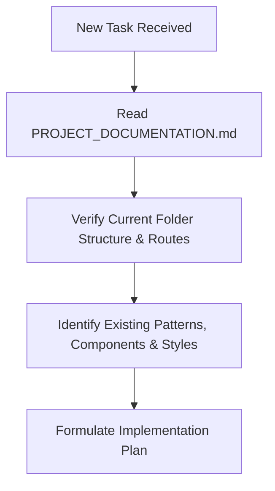
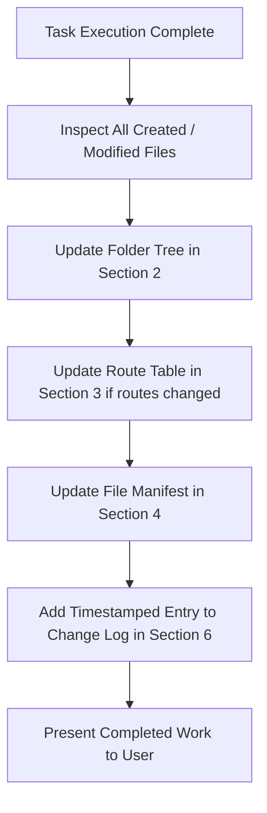

# RIS Project Documentation & Living Architecture Blueprint

> **CRITICAL AGENT PROTOCOL**:
> 1. **MANDATORY PRE-TASK CHECK**: Before starting any new task, feature, page, component, or code modification, you **MUST read this document first** to understand the current folder structure, routing table, existing components, and project conventions.
> 2. **MANDATORY POST-TASK SYNC**: At the conclusion of **EVERY** task where files/content are created, modified, or returned, you **MUST update this document** immediately to reflect the latest folder structure, updated/new file descriptions, routing changes, and append a record to the [Change Log](#change-log).

---

## 1. Project Overview

- **Project Name**: RIS (Reflex Industrial Solutions / Web Application)
- **Primary Framework**: Next.js 16.4.0 (App Router) with React 19.3.0
- **Language**: TypeScript 5 (Strict mode)
- **Styling**: Tailwind CSS v4 (`@tailwindcss/turbopack`)
- **Bundler / Compiler**: Next.js Turbopack with inline theme configuration
- **Code Quality**: ESLint 9 (Flat config), Prettier 3.9, Husky pre-commit git hooks
- **Repository Layout**: Project structure with `frontend/` containing the primary Next.js web application and root configuration.

---

## 2. Complete Folder Structure

Below is the verified, up-to-date workspace directory tree:

```text
/RIS/
├── .husky/                                 # Git automation hooks (active at root)
│   └── pre-commit                          # Pre-commit hook script with POSIX shebang & npm --prefix frontend
├── .vscode/                                # VS Code workspace preferences
│   └── settings.json                       # Workspace Git ignore limit configuration
├── frontend/                               # Next.js web application root
│   ├── .husky/                             # Frontend-local husky assets
│   │   └── pre-commit                      # Secondary hook reference
│   ├── app/                                # Next.js 16 App Router directory
│   │   ├── about/                          # Dedicated company overview & heritage page
│   │   │   └── page.tsx                    # About Us page route (/about)
│   │   ├── about-us/                       # Route alias for /about-us
│   │   │   └── page.tsx                    # Route alias re-exporting /about
│   │   ├── favicon.ico                     # Standard browser tab favicon
│   │   ├── globals.css                     # Global styles, Tailwind v4 imports & CSS variables
│   │   ├── layout.tsx                      # Root HTML layout integrating Navbar, Footer & Google Font Poppins
│   │   └── page.tsx                        # Root homepage landing view (Route: /) with HeroBannerCarousel and supporting sections
│   ├── components/                         # Reusable UI and application components
│   │   ├── common/                         # Common shared layouts & navigation
│   │   │   ├── Footer.tsx                  # Responsive global site footer
│   │   │   └── Navbar.tsx                  # Fully responsive top navigation bar & mobile drawer
│   │   └── home/                           # Home screen modular sections
│   │       ├── HeroBannerCarousel.tsx      # Split hero carousel (Left: content, Right: temporary banner visual)
│   │       ├── HomeAboutSection.tsx        # Elevated company overview & core business areas with layered visual composition
│   │       ├── HomeProductsSection.tsx     # 8-product bento grid & cinematic industrial facility hero showcase
│   │       ├── HomeQualitySection.tsx      # 8-stage Quality Gate lifecycle & analytical testing laboratory showcase
│   │       ├── HomeServicesSection.tsx     # 8 industrial engineering services showcase with engineer visual anchor
│   │       └── QuickServicesBar.tsx        # Floating curved services bar with 4 core industrial offerings & mouse indicator
│   ├── constants/                          # Shared constants & design tokens
│   │   └── colour.tsx                      # Brand palette color constants (cream, primaryDark, accent, secondary)
│   ├── data/                               # Application datasets and navigation configuration
│   │   ├── aboutPageData.ts                # Master dataset for About Us interior page (heritage, stats, infrastructure, offerings, ESG)
│   │   ├── footerData.ts                   # Structured configuration for footer content, links & contacts
│   │   ├── heroBannerData.ts               # Master dataset for all home screen modules (Hero slides, Quick Services, Home About, Products, Services, Quality)
│   │   ├── navbarData.ts                   # Navigation menu items configuration and interface
│   │   └── socialMediaData.ts              # Social media profile links, platforms, and metadata
│   ├── public/                             # Public static assets (images, icons, SVGs)
│   │   └── images/                         # Static visual assets directory
│   │       ├── about/                      # About section architectural imagery & telemetry assets
│   │       │   ├── water-treatment-engineers.jpg # Authentic industrial water plant with chemical engineers inspecting quality
│   │       │   ├── shape-6.png             # Decorative dot matrix cluster (top left)
│   │       │   └── shape-15.png            # Decorative dot matrix cluster (center partition)
│   │       ├── hero/                       # Authentic extracted hero banner imagery
│   │       │   ├── banner-1.jpg            # Authentic banner 1 (mountain lake mirror reflection)
│   │       │   ├── banner-2.jpg            # Authentic banner 2 (aquatic tree biosphere with fish)
│   │       │   ├── cta-bg.jpg              # Authentic eco-friendly visual (planet Earth in crystal water droplet)
│   │       │   ├── about-2.jpg             # Environmental green tree sprouting from water droplet
│   │       │   └── service-1.jpg           # Technical engineer water inspection at industrial plant
│   │       ├── products/                   # Products section authentic industrial photography
│   │       │   └── products-hero.jpg       # Modern automated reverse osmosis membrane facility & dosing skids
│   │       └── quality/                    # Quality section accredited testing laboratory photography
│   │           └── quality-lab.jpg         # Certified chemical quality analysts conducting analytical testing & titration in ISO lab
│   ├── types/                              # Shared custom TypeScript definitions & interfaces
│   ├── .gitignore                          # Git ignore list for frontend dependencies & build outputs
│   ├── .prettierignore                     # Files excluded from Prettier formatting
│   ├── .prettierrc                         # Prettier code formatting rules
│   ├── AGENTS.md                           # Next.js 16 agent rules & doc sync reminder
│   ├── eslint.config.mjs                   # ESLint 9 flat configuration with Next.js rules
│   ├── next-env.d.ts                       # Next.js ambient TypeScript declaration
│   ├── next.config.ts                      # Next.js 16 config with Turbopack CSS rules
│   ├── package.json                        # Dependencies, scripts, and package metadata
│   ├── package-lock.json                   # Deterministic dependency lockfile
│   ├── README.md                           # Standard Next.js getting started guide
│   └── tsconfig.json                       # TypeScript compiler options & `@/*` path aliases
├── package.json                            # Root workspace orchestration script proxies (dev, lint, format)
└── skills-lock.json                        # Installed agent skill lock definitions
```

---

## 3. File Routing & Navigation Architecture

The web application uses the **Next.js 16 App Router**. All routes reside within `frontend/app/`.

### Current Route Map

| URL Path | File Location | Route Type | Description & Purpose |
| :--- | :--- | :--- | :--- |
| `/` | `frontend/app/page.tsx` | Server/Client Page | Default root landing page featuring split Hero banner carousel, overlapping curved QuickServicesBar with 4 core industrial water & chemical management offerings (Audits, Pretreatment, Support/Maintenance, Waste Management), HomeAboutSection company overview, and HomeProductsSection showcasing the 8 core industrial product categories in an interactive bento grid with cinematic RO facility imagery. |
| `/about` | `frontend/app/about/page.tsx` | Server Page | Dedicated company overview and heritage page showcasing corporate background, 100+ years combined team experience, nationwide operational infrastructure pillars, 8 core water business areas, and environmental responsibility commitments. |
| `/about-us` | `frontend/app/about-us/page.tsx` | Route Alias | Route alias re-exporting `/about` to ensure seamless navigation parity across external links and demo references. |
| *(Layout)* | `frontend/app/layout.tsx` | Root Layout | Global shell wrapping all routes; injects Geist Sans/Mono fonts and `globals.css`. |

### Route Creation Conventions

1. **New Pages**: Create a folder under `frontend/app/<route-name>/page.tsx`.
2. **Nested Routes**: Create subfolders, e.g., `frontend/app/<section>/<subpage>/page.tsx`.
3. **Dynamic Routes**: Use bracket syntax, e.g., `frontend/app/patients/[id]/page.tsx`.
4. **API Endpoints**: Place route handlers inside `frontend/app/api/<endpoint>/route.ts`.
5. **Route Groups & Modals**: Use parentheses for logical grouping (e.g., `app/(dashboard)/layout.tsx`) without affecting URL path.

> **CRITICAL**: Every time a new route or page is created or modified, update the **Current Route Map** table above immediately!

---

## 4. File Manifest & Content Summary

Detailed description of core project files and their operational purpose:

### Root Level
- **[PROJECT_DOCUMENTATION.md]**: Master living document. Tracks architecture, folder structure, routing, content, and the history of changes.
- **[AGENTS.md]**: Workspace agent rules. Enforces mandatory pre-task inspection of `PROJECT_DOCUMENTATION.md` and mandatory post-task documentation updates.
- **[skills-lock.json]**: Tracks external and local agent skills installed in `.agents/skills`.

### Root Workspace Configuration
- **[.husky/pre-commit]**: Root Git pre-commit hook with POSIX shebang (`#!/usr/bin/env sh`) that automatically formats code with `npm --prefix frontend run format`, stages modifications with `git add -u`, and runs ESLint checks with `npm --prefix frontend run lint`.
- **[package.json]**: Root workspace orchestration `package.json` proxying standard lifecycle scripts (`dev`, `build`, `lint`, `format`, `format:check`) directly to the `frontend/` directory via `npm --prefix frontend run <script>`.
- **[.git/config]**: Configured with `core.hooksPath = .husky` to ensure Git invokes the root pre-commit hook during `git commit`.

### Frontend Core Configuration
- **[frontend/package.json]**:
  - Runtime: Next.js `16.4.0`, React `19.3.0`, React DOM `19.3.0`.
  - Dev tools: Tailwind CSS `^4`, `@tailwindcss/turbopack` `^4`, TypeScript `^5`, ESLint `^9`, Prettier `^3.9.10`, Husky `^9.1.7`.
  - Scripts:
    - `npm run dev`: Starts Turbopack development server.
    - `npm run build`: Compiles production bundle.
    - `npm run lint`: Executes ESLint checks.
    - `npm run format`: Formats code with Prettier.
    - `npm run format:check`: Validates Prettier compliance without writing.
- **[tsconfig.json]**: Configured with `@/*` path mapping to `./*` (resolves relative to `frontend/`), strict type checking, and ES2017+ target.
- **[next.config.ts]**: Configures Turbopack loaders for Tailwind CSS v4 (`@tailwindcss/turbopack`), experimental agent feedback, component caching, and partial prefetching.
- **[frontend/.husky/pre-commit]**: Pre-commit hook that automatically runs Prettier formatting with `npm --prefix frontend run format`, re-stages changed files with `git add -u`, and runs ESLint checks with `npm --prefix frontend run lint` before any git commit.

### Frontend Application Structure (`frontend/app/`)
- **[app/layout.tsx]**:
  - Root layout component configuring Google Font **Poppins** (`subsets: ["latin"]`, weights `300` through `800`).
  - Sets root `html` and `body` with `--font-poppins` and `font-sans` classes.
  - Embeds global `<Navbar />` and `<Footer />` shells around page content.
  - Injects `globals.css`.
- **[app/globals.css]**:
  - Imports Tailwind CSS v4 (`@import "tailwindcss";`).
  - Configures CSS variables for light/dark mode backgrounds (`#ffffff` / `#0a0a0a`) and foregrounds (`#171717` / `#ededed`).
  - Defines `@theme inline` mapping `--color-background`, `--color-foreground`, and `--font-sans: var(--font-poppins), sans-serif;`.
  - Sets global `body` typography to use `var(--font-poppins), sans-serif;`.
- **[app/page.tsx]**:
  - Main landing view component for route `/`.
  - Seamlessly renders the split `<HeroBannerCarousel />` followed by the floating `<QuickServicesBar />` core services showcase, `<HomeAboutSection />`, `<HomeProductsSection />`, `<HomeServicesSection />`, and `<HomeQualitySection />`.
- **[app/about/page.tsx]**:
  - Dedicated interior page component for route `/about` implemented as an **Editorial Folio** on the continuous `#F5EFE3` cream canvas, avoiding floating white box/card-in-card containers.
  - Impeccable typography & text alignment: Left-aligned chapter headlines with natural character tracking, comfortable masthead lead intro across `max-w-4xl`, and balanced 2-column editorial spreads with publication-grade text justification (`text-justify [text-justify:inter-word] [text-align-last:left] hyphens-auto`). Completely eliminates awkward narrow-column word stretching and rivers of white space.
  - Features the panoramic cinematic visual frame (`water-treatment-engineers.jpg`) with active telemetry beacon, ISO 9001:2015 badge, operational clarifier weir (`video-1.jpg`), direct hotline (`044 42805983`), and plant survey action.
  - Formats authentic About Us content into 3 chapters: Chapter 01 (Corporate Scope & Leadership), Chapter 02 (Heritage & Strategic Infrastructure), and Chapter 03 (The Offerings & Environmental Responsibility) with closing customer commitment and direct contact footer strip.
- **[app/about-us/page.tsx]**:
  - Route alias re-exporting `/about` to ensure seamless backwards compatibility for external links and demo references.
- **[data/aboutPageData.ts]**:
  - Authoritative master dataset configuring all authentic copy for the About Us interior page (`ABOUT_PAGE_DATA`, `AboutPageData`, `AboutChapter`), structured cleanly into 3 narrative chapters, corporate masthead, headline lines, lead narrative, offerings, environmental mandate, and direct hotline details.
- **[components/home/HomeAboutSection.tsx]**:
  - Client component implementing an elevated, agency-grade company overview and core business area capabilities showcase for **Reflex Industrial Solutions**.
  - Brand Palette Architecture: Rendered strictly with `COLOUR_PALETTE` (`cream: #F5EFE3`, `primaryDark: #4F5B2A`, `accent: #B8892D`, `secondary: #D8C9A8`), maintaining zero color boundary or seam with the preceding sections.
  - Left Column (`lg:col-span-6 xl:col-span-6`): Features a modern pill tag with active gold beacon, stately Poppins headline with curved accent underline, fluid editorial paragraph detailing industrial chemistry programs across heavy industries, an interactive 2x2 bento grid of core business area capability pods (Pre Treatment Chemicals, Boiler Water Treatment, Fuel & Fire Side Treatment, Cooling Water Treatment) with bespoke vector insignia and hover micro-elevations, and a primary pill CTA button with trailing circular arrow badge alongside a secondary product exploration link.
  - Right Column (`lg:col-span-6 xl:col-span-6`): Single cohesive, high-impact architectural frame (`rounded-[2.5rem]`, double-bezel white glass casing) housing an authentic photograph of chemical engineers inspecting industrial water treatment facility operations (`water-treatment-engineers.jpg`). Features integrated, non-overlapping live telemetry status tags (top-left live "24/7 Field Operations Active" pulsing emerald pill, top-right "ISO 9001:2015 Certified" badge) and an integrated bottom frosted glass telemetry bar hosting the direct technical hotline (`044 42805983`) and process reliability metric (`100% Zero Harm Standard`).
- **[components/home/HomeProductsSection.tsx]**:
  - Client component implementing a modern, luxury industrial product showcase replacing dated reference templates.
  - Symmetrical & Balanced Typography: Refined section header featuring an architectural eyebrow framed by symmetrical gold horizontal accent rules (`COLOUR_PALETTE.accent`), a stately two-line headline hierarchy (`High-Performance Chemical Formulations` in charcoal `#1A2010` and `& Industrial Treatment Systems` in olive `COLOUR_PALETTE.primaryDark`), and a centered, comfortably balanced description paragraph. Completely eliminates awkward 3-line word wraps, hanging ampersands, and misaligned SVG underlines.
  - Features an architectural cinematic hero banner (`products-hero.jpg`) displaying automated multi-stage reverse osmosis membrane arrays and dosing skids with integrated telemetry pills.
  - Displays the 8 core industrial product categories in an interactive 4-column bento grid (Boiler Water Treatment, Fuel & Fireside Treatment, Cooling Water Treatment, Raw & Wastewater Treatment, Reverse Osmosis / UF / Nano, Speciality Products, Plants & Monitoring Equipment, Boiler Feed Water Treatment). Each card hosts custom brand iconography, step numbering, category taglines, concise industrial capability descriptions, and hover arrow transitions.
  - Centralized action hub linking to `/products` catalog and `/contact` for technical data sheets.
- **[components/home/HomeServicesSection.tsx]**:
  - Client component implementing a balanced, single-frame architectural showcase for the 8 core industrial engineering services.
  - Symmetrical 1:1 Height Balance: Encloses the authentic field engineer photography (`service-1.jpg`) on the left and the 8 streamlined services on the right inside a unified white glass container (`rounded-[2.25rem] sm:rounded-[2.75rem]`, `p-6 sm:p-8 lg:p-12`). Eliminates the previous lopsided vertical void by matching image height 1:1 with the checklist.
  - Streamlined Checklist Presentation: Replaced verbose multi-sentence paragraphs, bulky 4-tier cards, and redundant taglines with clean, high-impact service rows featuring brand checkmark badges in `COLOUR_PALETTE.primaryDark`, crisp official titles, and concise 1-line engineering scopes.
  - Embedded Actions: Integrated live field telemetry badge, hotline callout to `044 42805983`, and bottom action buttons for scheduling plant audits.
- **[components/home/HomeQualitySection.tsx]**:
  - Client component implementing a clean, bright, and authoritative **Light Architectural Directive Board** for the Quality Policy on the continuous `#F5EFE3` cream canvas, avoiding dark themes and card-in-card bloat.
  - Symmetrical Directive Board: Master white glass container (`rounded-[2.25rem] sm:rounded-[2.75rem]`, `bg-white/95`, `p-6 sm:p-10 lg:p-14`, `border border-stone-200/90`) featuring a gold-flanked eyebrow (`— OUR COMMITMENT —`), stately Poppins headline, and concise preamble.
  - Balanced 2-Column Policy Directives: Formatted the complete, authentic 8 Quality Policy rules into clean, lightweight directive rows (`grid-cols-1 md:grid-cols-2`) with brand olive checkmark badges (`COLOUR_PALETTE.primaryDark`), gold rule indicators (`Rule 01` - `Rule 08`), and legible typography.
  - Integrated Trust Guarantee Ribbon: Embedded bottom assurance strip (`#FAF7F2`) displaying 100% Certificate of Quality (COA), Zero-Defect Release Standard, and Retained Batch Sample Protocol alongside direct CTA links to `/quality` and `/contact`.
- **[data/heroBannerData.ts]**:
  - Authoritative master dataset configuring all modular content for the home screen:
    - **Hero Slides (`HERO_SLIDES`, `HeroSlide`)**: 3 rotating carousel slides with typewriter headlines, background banners, and stats.
    - **Core Services (`QUICK_SERVICES_DATA`, `QuickServiceItem`)**: 4 industrial offerings (Audits, Pretreatment, Support, Chemical Waste) for the curved Serpentine stream.
    - **Company Overview (`HOME_ABOUT_DATA`, `HomeAboutData`, `BusinessAreaCard`)**: Reflex Industrial Solutions overview, 2x2 bento business area capability pods, live operations telemetry tags, and direct technical hotline.
    - **Products Portfolio (`HOME_PRODUCTS_DATA`, `HomeProductsSectionData`, `ProductItem`)**: 8 core industrial product categories, cinematic hero image metadata, category taglines, call-to-action routing, and balanced two-line headline fields (`eyebrow`, `titleLine1`, `titleLine2`).
    - **Industrial Services (`HOME_SERVICES_DATA`, `HomeServicesSectionData`, `IndustrialServiceItem`)**: 8 streamlined industrial engineering capabilities (`id`, `stepNumber`, `title`, `scope`, `href`), on-site engineer imagery metadata, and hotline details.
    - **Quality Policy (`HOME_QUALITY_DATA`, `HomeQualitySectionData`, `QualityPolicyPoint`)**: Corporate quality policy statement and the authentic 8 short, simple quality rules (`id`, `number`, `text`).
- **[public/images/about/]**:
  - Directory hosting assets for the about section: `water-treatment-engineers.jpg` (authentic high-impact industrial water treatment and chemical dosing facility with on-site engineers), `shape-6.png` (top-left dot matrix cluster), and `shape-15.png` (center partition dot matrix cluster).
- **[public/images/products/]**:
  - Directory hosting assets for the products section: `products-hero.jpg` (modern automated reverse osmosis membrane facility and chemical dosing skids).
- **[public/images/quality/]**:
  - Directory hosting assets for the quality section: `quality-lab.jpg` (authentic high-resolution photography of certified chemical analysts conducting precision titration and spectrophotometry in an ISO 9001 accredited testing laboratory).
- **[components/home/QuickServicesBar.tsx]**:
  - Client component implementing a dynamic, non-rectangular **Serpentine Hydro-Wave Stream** layout with scroll-driven parallax movement and staggered entrance animations.
  - Seamless Transition: Seamlessly connects directly to the hero section with zero color boundary or dead gap, sharing the same solid `COLOUR_PALETTE.cream` (`#F5EFE3`) background with tight top padding (`pt-2 sm:pt-4`).
  - Structure & Geometry: 4 standalone, organically sculpted pods (`rounded-[2.25rem] sm:rounded-[2.6rem]`) with individual curved wave crowns arranged with alternating staggered vertical wave elevations across the viewport.
  - Scroll & Kinetic Motion: Connected via an ambient SVG serpentine spline conduit with dynamic dash-offset flow scrubbing on scroll, subtle alternating parallax vertical drifting, and floating background micro-droplets.
  - Clean & Focused Content: Streamlined to focus exclusively on core service content per user request (step number badge, category pill, bespoke brand vector insignia on organic hydro-well, 2-line Poppins title, and concise service description), removing unnecessary telemetry progress bars and metric boxes.
  - Data Integration: Dynamically bound to `QUICK_SERVICES_DATA` and `QuickServiceItem` directly imported from `frontend/data/heroBannerData.ts`.
- **[components/home/HeroBannerCarousel.tsx]**:
  - Client component implementing a split-layout hero banner carousel with dynamic typewriter character streaming and layout-stabilized vertical containers.
  - Seamless Background: Rendered on uniform `COLOUR_PALETTE.cream` (`#F5EFE3`) with overflowing background blur mesh blobs removed to eliminate any harsh edge seam or color split with downstream sections.
  - Left Column (`lg:col-span-7 xl:col-span-7`): Generously widened content container accommodating a clean 3-line headline with `whitespace-pre-line`, typewriter character streaming, dynamic slide eyebrow badge with pulsing beacon, fluid description paragraph, primary "Read More" CTA with nested micro-animated button-in-button trailing icon, secondary action link, next/prev arrow buttons, auto-play pause/resume toggle, and interactive thumbnail pill selectors with animated progress bar indicators. Sized with optimized vertical padding (`pt-6 sm:pt-8 lg:pt-10 pb-4 sm:pb-6`) without viewport-locking min-height constraints.
  - Right Column (`lg:col-span-5 xl:col-span-5`): Double-bezel hardware enclosure (`rounded-[2rem]` shell + inner glass core) hosting clean, unobstructed high-resolution banner imagery with smooth cross-fade zoom transitions and sleek bottom-right slide switcher indicators.
- **[public/images/hero/]**:
  - Directory hosting authentic extracted photography from TrueBlue Chem India directly reflecting each slide's content: `banner-1.jpg` (pristine mountain lake reflection for reliable chemical solutions), `banner-2.jpg` (aquatic tree biosphere with fish for tailored chemical innovation), `cta-bg.jpg` (Earth inside a crystal water droplet for sustainability & eco-friendly practices), and supporting operational assets (`about-2.jpg`, `service-1.jpg`).
- **[components/common/Navbar.tsx]**:
  - Client component featuring a **Floating Glassmorphic Pill Navigation Bar** (`rounded-full` capsule geometry).
  - Floating sticky container (`sticky top-3 sm:top-5`) with frosted glass backdrop blur (`backdrop-blur-xl sm:backdrop-blur-2xl`), white hairline reflection highlight, and dynamic multi-layer elevation shadow on scroll.
  - Top-left circular industrial brand emblem with Poppins typography (`RIS Solutions`) and micro tagline.
  - Center capsule channel hosting desktop navigation items (**Home**, **About Us**, **Products**, **Quality**, and **Industrial Services**) with rounded-full pill active highlights and gold accent beacon.
  - Right rounded-full **Contact Us** action pill button with micro-animated trailing arrow.
  - Responsive floating **Glass Island Dropdown** for mobile devices with rounded-2xl navigation cards, contact button, and direct phone link.
- **[components/common/Footer.tsx]**:
  - Client component implementing a modern structured industrial footer with a clean, borderless crescent moon curved top boundary flowing seamlessly from top-left to right directly into `COLOUR_PALETTE.primaryDark`.
  - Column 1: Company Profile with a dedicated badge card housing the logo and ISO 9001:2015 certification subtext, followed by company summary paragraph and "...Read More" link.
  - Column 2: "Quick Links" menu (About Us, Products, Industries Served, Quality, Contact Us).
  - Column 3: "working hours" schedule.
  - Column 4: "Get In Touch" with email, phone, and 4 circular brand social media buttons (Facebook, Twitter/X, Instagram, LinkedIn).
  - Bottom bar: Full-width centered copyright notice.
- **[constants/colour.tsx]**:
  - Defines standard project brand color tokens: `cream` (`#F5EFE3`), `primaryDark` (`#4F5B2A`), `accent` (`#B8892D`), and `secondary` (`#D8C9A8`).
- **[data/footerData.ts]**:
  - Centralized dataset and TypeScript interface `FooterConfig` defining company profile, ISO certification, quick links, working hours, get-in-touch title, and copyright strings (with contact and social media information cleanly decoupled into `data/socialMediaData.ts`).
- **[data/navbarData.ts]**:
  - Centralized dataset and TypeScript interface `NavItem` configuring all primary navigation links, labels, routes, icons, and descriptions.
- **[data/socialMediaData.ts]**:
  - Centralized dataset and TypeScript interfaces `SocialMediaLink` and `ContactDetails` configuring official contact details (`email: info@ris-industries.com`, `phone: 044 42805983`) as well as external social media profiles (Facebook, Twitter/X, Instagram, LinkedIn).
- **[types/]**:
  - Dedicated folder for application TypeScript interfaces, DTOs, and component prop definitions.

---

## 5. Living Documentation Sync Protocol

Every AI agent and developer working on this codebase must adhere strictly to the following 3-phase lifecycle:

### Phase 1: Pre-Execution Inspection

1. Always read `PROJECT_DOCUMENTATION.md` before generating or modifying any code.
2. Confirm existing file paths, route structures, and components to prevent duplicate work or broken paths.

### Phase 2: Active Implementation
1. Adhere to React 19 and Next.js 16 conventions (App Router, Server Components by default, Client Components only when interactive).
2. Use Tailwind CSS v4 utility classes and existing CSS variables.
3. Keep track of all files created, modified, moved, or deleted.

### Phase 3: Post-Execution Documentation Sync

1. **Update Folder Tree**: Reflect any added, deleted, or renamed directories and files.
2. **Update Route Table**: Add new URL endpoints, parameters, or page descriptions.
3. **Update File Manifest**: Document new components, services, types, or utilities.
4. **Append Change Log**: Add an entry under Section 6 with date, description of changes, files touched, and next steps.

---

## 6. Change Log

| Date (YYYY-MM-DD) | Summary of Changes | Files Touched / Created | Next Steps / Notes |
| :--- | :--- | :--- | :--- |
| 2026-10-19 | Resolved text misalignment and unnatural word spacing on the About Us page (`frontend/app/about/page.tsx`) per user feedback ("it is not aligned so fix this" and "the text should be in a proper justigy as well"). Eliminated the narrow-column bold lead block that caused awkward word stretching ("petroleum ... refining"). Restructured the layout into an **Editorial Folio** on the continuous `#F5EFE3` cream canvas: (1) Editorial masthead with comfortable, full-measure lead narrative (`max-w-4xl`) with smooth, even line breaks; (2) Crisp, left-aligned section and chapter headlines (`text-left`) with natural letter-spacing; (3) Balanced 2-column editorial grids (`grid-cols-1 md:grid-cols-2`) for all body paragraphs featuring publication-grade text justification (`text-justify [text-justify:inter-word] [text-align-last:left] hyphens-auto`) ensuring straight, flush margins without gaping spaces; and (4) Structured dataset `frontend/data/aboutPageData.ts` into clean chapters (Corporate Scope & Leadership, Heritage & Strategic Infrastructure, The Offerings & Environmental Responsibility). | `frontend/app/about/page.tsx`<br>`frontend/data/aboutPageData.ts`<br>`PROJECT_DOCUMENTATION.md` | Flawless text alignment and book-grade justification verified across all chapters. |
| 2026-10-19 | Designed and implemented a brand-new **Narrative Editorial Chronicle** UI for the About Us page (`frontend/app/about/page.tsx`) per user feedback ("create a new ui for this dont need this ui"). Replaced the previous single-card layout with a multi-chapter editorial structure strictly centered on authentic About Us content: (1) Editorial hero masthead with breadcrumb capsule, gold-flanked eyebrow, and 4-metric Quick Facts strip (100+ Years Leadership, 20+ Years Industry Association, Pan-India Network, Turnkey Services); (2) Chapter 01 (Who We Are): Architectural white card with corporate narrative, core sectors served chips (Fertilizer, Refining, Petrochemicals, Power, Mining, Chemicals), gold left-accented executive quote callout, and authentic photography composition (`water-treatment-engineers.jpg`, operational clarifier weir, and hotline dialer `044 42805983`); (3) Chapter 02 (Heritage & Strategic Infrastructure): Engineering roots in Tamil Nadu, rapid national expansion, and 3 strategic advantage cards (Chemical Manufacturing Facilities, Bulk Storage Terminals & Warehouses, Fast Turnaround & Cost Savings); and (4) Bottom direct technical connection banner. Synced `frontend/data/aboutPageData.ts`. | `frontend/app/about/page.tsx`<br>`frontend/data/aboutPageData.ts`<br>`PROJECT_DOCUMENTATION.md` | Brand-new chapter-based editorial About Us UI active; zero repetitive layouts or product bloat. |
| 2026-10-19 | Refactored the dedicated About Us page (`frontend/app/about/page.tsx`) to strictly and exclusively feature authentic **About Us** content per user directive ("in the about us have to add a about us only as well, dont have to attach any other information, only needs to contain a about contain so implement it correctly"). Eliminated duplicate offerings, product areas, stats bars, and environmental manifestos that belong to other sections. Structured the page around a grand, unified architectural card on the uniform `#F5EFE3` cream canvas: authentic 7-paragraph heritage and operational narrative, executive leadership quote (100+ years experience), 4 core company highlights (100+ Years Collective Leadership, Entire Gamut of Industries, Extremely Customized Programs, Strategic Asset Network), sticky architectural frame with certified field engineers (`water-treatment-engineers.jpg`), operational clarifier visual (`video-1.jpg`), direct technical hotline (`044 42805983`), and contact consultation banner. Synced `frontend/data/aboutPageData.ts`. | `frontend/app/about/page.tsx`<br>`frontend/data/aboutPageData.ts`<br>`PROJECT_DOCUMENTATION.md` | Pure, focused About Us view active with zero unrelated attachments or duplicate bloat. |
| 2026-10-19 | Implemented the dedicated **About Us** page (`frontend/app/about/page.tsx`) and alias route (`frontend/app/about-us/page.tsx`) referencing `https://truebluechemindia.com/about-us` with agency-grade industrial architecture under **Reflex Industrial Solutions**. Structured the page into 7 comprehensive sections: Hero breadcrumb header on uniform `#F5EFE3` cream canvas, company heritage narrative with multi-layered visual frame (`water-treatment-engineers.jpg`, clarifier weir, and hotline dialer `044 42805983`), 4-metric corporate milestone stats bar (100+ years combined team experience, 8+ industry verticals, 100% compliance, 24/7 field response), 4-pillar operational infrastructure bento grid (chemical manufacturing, bulk storage, analytical testing, on-site engineering), 8 core water treatment business areas grid, environmental stewardship & ESG compliance manifesto, and direct technical consultation CTA. Created master dataset `frontend/data/aboutPageData.ts`. | `frontend/app/about/page.tsx`<br>`frontend/app/about-us/page.tsx`<br>`frontend/data/aboutPageData.ts`<br>`PROJECT_DOCUMENTATION.md` | Interior About Us route fully functional without 404s; aligned with brand palette and conventions. |
| 2026-10-19 | Redesigned `HomeQualitySection.tsx` with a clean, bright, and authoritative **Light Architectural Directive Board** on the uniform `#F5EFE3` cream canvas per user feedback ("dont set compleate dark so fix implement ti"). Eliminated dark mode styling and repetitive split-box layouts. Implemented a master white glass board (`rounded-[2.25rem] sm:rounded-[2.75rem]`, `p-6 sm:p-10 lg:p-14`, `border border-stone-200/90`), gold-flanked eyebrow (`— OUR COMMITMENT —`), concise narrative preamble, and an impeccably balanced 2-column directive grid (`md:grid-cols-2`) showcasing the authentic 8 Quality Policy rules with brand olive checkmark badges (`COLOUR_PALETTE.primaryDark`) and gold rule indicators (`Rule 01` to `Rule 08`). Embedded a bottom trust guarantee ribbon (`#FAF7F2`) highlighting 100% Certificate of Quality (COA), Zero-Defect Standard, and Retained Batch Archive alongside direct action buttons. | `frontend/components/home/HomeQualitySection.tsx`<br>`PROJECT_DOCUMENTATION.md` | Clean, bright light UI implemented with 100% brand consistency; zero dark mode conflicts. |
| 2026-10-19 | Completely redesigned the Quality Policy showcase (`HomeQualitySection.tsx`) per user feedback: eliminated repetitive white split-box layout and cards-in-cards. Built an agency-grade **Cinematic Dark Theater** container (`rounded-[2.25rem] sm:rounded-[3rem]`, `#141C0D` deep forest-charcoal, precision molecular dot grid, and ambient gold/emerald radial glows). Formatted the authentic 8 Quality Policy rules from the demo reference across a balanced 2-column grid (`lg:grid-cols-2`) with custom gold-accented checkmark badges and protocol index numbering. Implemented an interactive "Read More / Read Less" toggle button on mobile to keep the mobile view compact while matching the user's reference. Embedded a bottom 3-pillar quality assurance ribbon (100% Certificate of Quality, Zero-Defect Release, Retained Batch Samples) and action buttons linking to quality manuals and technical documentation. | `frontend/components/home/HomeQualitySection.tsx`<br>`PROJECT_DOCUMENTATION.md` | Quality Policy section now has a distinct, stunning cinematic identity; 100% aligned with user reference. |
| 2026-10-19 | Implemented the Home Screen Quality Policy showcase (`HomeQualitySection.tsx`) replacing the dated dark blue droplet and raw bulleted text from the demo with a modern, agency-grade quality architecture. Generated and linked authentic high-resolution commercial photography of certified analytical chemists performing precision titration and spectrophotometry in an ISO 9001:2015 accredited laboratory (`quality-lab.jpg`). Designed a 4-metric quality KPI bar, a cinematic laboratory hero showcase with live telemetry badges, and an interactive 8-stage Quality Gate lifecycle bento grid (Raw Material Inflow Rejection, Controlled Deviation Approval, Production Manual SOPs, Finished Product Total Analytics, 100% Parameter Dispatch Authorization, Retained Reference Sample Archive, Periodic In-Stock Batch Sampling, and Mandatory Certificate of Quality COA). Integrated the complete dataset into the master file `frontend/data/heroBannerData.ts` (`HOME_QUALITY_DATA`, `QualityGateItem`, `QualityMetricItem`) and mounted into `frontend/app/page.tsx` on the uniform cream canvas. | `frontend/data/heroBannerData.ts`<br>`frontend/components/home/HomeQualitySection.tsx`<br>`frontend/app/page.tsx`<br>`frontend/public/images/quality/quality-lab.jpg`<br>`PROJECT_DOCUMENTATION.md` | Complete 8-stage quality gate lifecycle and analytical testing showcase active; zero separate data files created. |
| 2026-10-19 | Resolved UI balance and verbose data bloat in `HomeServicesSection.tsx` per user feedback: eliminated the bulky 4-tier cards and lopsided left-side empty void. Enclosed the section into a single unified master architectural white glass container (`rounded-[2.25rem] sm:rounded-[2.75rem]`, `p-6 sm:p-8 lg:p-12`) establishing an exact 1:1 vertical height symmetry between the left engineer photo (`service-1.jpg`) and the right checklist. Streamlined `frontend/data/heroBannerData.ts` (`HOME_SERVICES_DATA`, `IndustrialServiceItem`) to replace heavy multi-sentence paragraphs with crisp official titles and concise 1-line engineering scopes with olive checkmarks (`COLOUR_PALETTE.primaryDark`). | `frontend/components/home/HomeServicesSection.tsx`<br>`frontend/data/heroBannerData.ts`<br>`PROJECT_DOCUMENTATION.md` | Equal 1:1 height balance achieved; zero empty voids and clean focused data. |
| 2026-10-19 | Implemented the Home Screen Industrial Services showcase (`HomeServicesSection.tsx`) restructuring the 8 core engineering capabilities from the demo (Water and Energy Audits, System Survey & Diagnostics, Supply of Pretreatment Systems, Erection, Commissioning & O&M, Annual Maintenance Contracts, Supply of Spares, Regular Technical Support, Water & Scale Analysis) into a modern, luxury industrial architecture. Integrated the authentic on-site engineer field inspection photograph (`service-1.jpg`) into a sticky left-column architectural frame featuring a pulsing emerald telemetry pill, frosted glass hotline badge (`044 42805983`), and an engineering assurance checklist. Designed an interactive 2-column bento grid for the 8 services on the right, backed by the unified master dataset `frontend/data/heroBannerData.ts` (`HOME_SERVICES_DATA`, `IndustrialServiceItem`). Mounted directly into `frontend/app/page.tsx` on the uniform cream canvas. | `frontend/data/heroBannerData.ts`<br>`frontend/components/home/HomeServicesSection.tsx`<br>`frontend/app/page.tsx`<br>`PROJECT_DOCUMENTATION.md` | All 8 industrial services implemented with rich data modeling; zero separate data files created. |
| 2026-10-19 | Resolved formatting and alignment defects in `HomeProductsSection.tsx` header per user feedback: eliminated the awkward 3-line headline wrap, hanging ampersand, and misaligned SVG underline. Replaced the generic breadcrumb-style pill with an architectural eyebrow flanked symmetrically by gold accent rules (`COLOUR_PALETTE.accent`), and structured the headline into two perfectly balanced, stately lines (`High-Performance Chemical Formulations` in charcoal `#1A2010` and `& Industrial Treatment Systems` in olive `#4F5B2A`). Calibrated the description paragraph to a comfortable `max-w-2xl` center alignment, normalized section top padding (`pt-8 sm:pt-12 lg:pt-14`), and updated `frontend/data/heroBannerData.ts` with typed fields `eyebrow`, `titleLine1`, and `titleLine2`. | `frontend/components/home/HomeProductsSection.tsx`<br>`frontend/data/heroBannerData.ts`<br>`PROJECT_DOCUMENTATION.md` | Products section header is now impeccably balanced, symmetrical, and aligned. |
| 2026-10-19 | Implemented the Home Screen Products showcase (`HomeProductsSection.tsx`) with a completely redesigned, luxury industrial architecture replacing the dated demo template. Generated and linked authentic high-resolution industrial photography of automated reverse osmosis membrane arrays and dosing skids (`products-hero.jpg`). Designed an interactive 4-column bento grid showcasing the 8 core industrial product categories (Boiler Water Treatment, Fuel & Fireside, Cooling Water, Raw & Wastewater, RO / UF / Nano, Speciality Products, Plants & Monitoring Equipment, Boiler Feed Water) with bespoke iconography, category step numbering, and hover micro-elevations. Integrated all product copy and routing directly into the master dataset `frontend/data/heroBannerData.ts` and mounted into `frontend/app/page.tsx` on the uniform cream canvas. | `frontend/data/heroBannerData.ts`<br>`frontend/components/home/HomeProductsSection.tsx`<br>`frontend/app/page.tsx`<br>`frontend/public/images/products/products-hero.jpg`<br>`PROJECT_DOCUMENTATION.md` | Products showcase active with 8 industrial offerings; zero separate data files created. |
| 2026-10-19 | Consolidated all home screen data into the single master file `frontend/data/heroBannerData.ts` and deleted redundant file `frontend/data/homeAboutData.ts` per user request. Enhanced `heroBannerData.ts` to export `HOME_ABOUT_DATA`, `BusinessAreaCard`, and `HomeAboutData` alongside `HERO_SLIDES` and `QUICK_SERVICES_DATA`, unifying all three home screen sections under one source of truth. Updated `HomeAboutSection.tsx` import paths to point directly to `@/data/heroBannerData`. | `frontend/data/heroBannerData.ts`<br>`frontend/data/homeAboutData.ts` *(deleted)*<br>`frontend/components/home/HomeAboutSection.tsx`<br>`PROJECT_DOCUMENTATION.md` | Single unified dataset architecture preserved across all home components. |
| 2026-10-19 | Eliminated excessive vertical space and void gap between `QuickServicesBar.tsx` and `HomeAboutSection.tsx` per user feedback. Reduced `HomeAboutSection.tsx` top padding from `py-18 sm:py-24 lg:py-32` down to `pt-4 sm:pt-6 lg:pt-8 pb-16 sm:pb-20 lg:pb-24` and tightened `QuickServicesBar.tsx` bottom padding from `pb-16 sm:pb-20 lg:pb-24` down to `pb-4 sm:pb-6 lg:pb-8`, collapsing the gap from over 224px to a snug, natural transition that seamlessly flows directly from the curved service pods into the company overview. | `frontend/components/home/HomeAboutSection.tsx`<br>`frontend/components/home/QuickServicesBar.tsx`<br>`PROJECT_DOCUMENTATION.md` | Vertical gap between services pods and about section is now compact, balanced, and gap-free. |
| 2026-10-19 | Redesigned the visual imagery and presentation UI in `HomeAboutSection.tsx` per user feedback: eliminated messy overlapping boxes, floating cards, and conceptual tree droplet imagery. Replaced them with an authentic, high-impact industrial photograph of chemical engineers actively monitoring chemical dosing and water quality filtration (`water-treatment-engineers.jpg`). Implemented a unified, double-bezel modern architectural frame (`rounded-[2.5rem]`, subtle specular glass highlight sheen) with integrated live telemetry tags (top-left "24/7 Field Operations Active" pulsing emerald pill, top-right "ISO 9001:2015 Certified" badge) and an integrated bottom frosted glass telemetry bar hosting the direct technical hotline (`044 42805983`) and process reliability metric (`100% Zero Harm Standard`). Synced dataset `frontend/data/homeAboutData.ts`. | `frontend/data/homeAboutData.ts`<br>`frontend/components/home/HomeAboutSection.tsx`<br>`frontend/public/images/about/water-treatment-engineers.jpg`<br>`PROJECT_DOCUMENTATION.md` | Single cohesive architectural frame with clean telemetry verified; zero messy overlapping boxes. |
| 2026-10-19 | Replaced generic reference company branding with the official repository naming convention **Reflex Industrial Solutions** (RIS). Implemented the home overview and capabilities section (`HomeAboutSection.tsx`) with an elevated, agency-grade design utilizing the brand `COLOUR_PALETTE` (`cream: #F5EFE3`, `primaryDark: #4F5B2A`, `accent: #B8892D`, `secondary: #D8C9A8`). Built an asymmetric, layered visual composition featuring the water droplet tree biosphere visual (`about-2.jpg`), floating 24/7 technical hotline glass card (`044 42805983`), and inset industrial clarifier weir image (`video-1.jpg`). Replaced plain text bullet points with an interactive 2x2 bento grid of core business area capability pods (Pre Treatment Chemicals, Boiler Water Treatment, Fuel & Fire Side Treatment, Cooling Water Treatment) backed by the typed master dataset `frontend/data/homeAboutData.ts`. Integrated seamlessly into `frontend/app/page.tsx` on the uniform cream canvas. | `frontend/data/homeAboutData.ts`<br>`frontend/components/home/HomeAboutSection.tsx`<br>`frontend/app/page.tsx`<br>`frontend/public/images/about/*`<br>`PROJECT_DOCUMENTATION.md` | All home sections (HeroBannerCarousel, QuickServicesBar, HomeAboutSection) are unified under the official brand identity and color tokens. |
| 2026-10-17 | Resolved ESLint `react-hooks/set-state-in-effect` pre-commit error in `HeroBannerCarousel.tsx` by relocating synchronous `setTypedTitle` and `setIsTyping` state updates inside the asynchronous `setTimeout` callback. Replaced `useEffect` mount-state in `QuickServicesBar.tsx` with React's idiomatic `useSyncExternalStore` hook, eliminating all cascading render lint errors while preserving 100% SSR hydration parity. | `frontend/components/home/HeroBannerCarousel.tsx`<br>`frontend/components/home/QuickServicesBar.tsx`<br>`PROJECT_DOCUMENTATION.md` | Commit hook (Prettier + ESLint) and SSR rendering now pass cleanly with zero errors. |
| 2026-10-17 | Fixed blank black/void gap above and around the floating pill navbar. Removed default Tailwind dark mode root override (`--background: #0a0a0a`) from `globals.css` and enforced solid `COLOUR_PALETTE.cream` (`#F5EFE3`) across `html` and `body` in both `globals.css` and `layout.tsx`. Switched `Navbar.tsx` from `sticky` to `fixed top-3 sm:top-5 inset-x-0` floating overlay, and calibrated `HeroBannerCarousel.tsx` top padding to `pt-24 sm:pt-28 lg:pt-32` so the hero extends to the very top edge and the glassmorphic pill floats directly over the hero banner with zero gaps. | `frontend/app/globals.css`<br>`frontend/app/layout.tsx`<br>`frontend/components/common/Navbar.tsx`<br>`frontend/components/home/HeroBannerCarousel.tsx`<br>`PROJECT_DOCUMENTATION.md` | Top gap completely eliminated; pill floats seamlessly over uniform cream canvas. |
| 2026-10-17 | Redesigned `Navbar.tsx` into a **Floating Glassmorphic Pill** navigation bar. Implemented capsule container geometry (`rounded-full`, `max-w-6xl`, `sticky top-3 sm:top-5`) with frosted glass backdrop blur (`backdrop-blur-xl sm:backdrop-blur-2xl`), multi-tier elevation shadow, circular industrial logo badge, rounded-full active pill link indicators with gold micro-beacon, rounded-full \"Contact Us\" action button with nested arrow circle, and an expandable floating mobile glass island dropdown. | `frontend/components/common/Navbar.tsx`<br>`PROJECT_DOCUMENTATION.md` | Floating glassmorphic pill design matches modern premium UI standards. |
| 2026-10-17 | Removed redundant files `frontend/data/homebannerData.ts` and `frontend/data/quickServicesData.ts` per user request. Consolidated all home banner carousel slides (`HERO_SLIDES`, `HeroSlide`) and core industrial services (`QUICK_SERVICES_DATA`, `QuickServiceItem`) into the single authoritative file `frontend/data/heroBannerData.ts`. Updated `QuickServicesBar.tsx` import path to point directly to `heroBannerData.ts`. | `frontend/data/homebannerData.ts` *(deleted)*<br>`frontend/data/quickServicesData.ts` *(deleted)*<br>`frontend/data/heroBannerData.ts`<br>`frontend/components/home/QuickServicesBar.tsx`<br>`PROJECT_DOCUMENTATION.md` | Data structure streamlined with zero redundant data files. |
| 2026-10-17 | Integrated the 4 core industrial quick services dataset (`QUICK_SERVICES_DATA`, `QuickServiceItem`) directly into `frontend/data/heroBannerData.ts` and created `frontend/data/homebannerData.ts` as an alias module re-exporting all hero banner and quick services items. Re-exported them in `quickServicesData.ts` to preserve backwards compatibility across all components. | `frontend/data/heroBannerData.ts`<br>`frontend/data/homebannerData.ts`<br>`frontend/data/quickServicesData.ts`<br>`PROJECT_DOCUMENTATION.md` | Data is now unified and accessible from `heroBannerData.ts`, `homebannerData.ts`, and `quickServicesData.ts`. |
| 2026-10-17 | Eliminated the visual separation, harsh dark gradient seam, and excessive vertical gap between `HeroBannerCarousel.tsx` and `QuickServicesBar.tsx`. Removed overflowing background blur mesh blobs (`primaryDark`, `accent`, `secondary`) from both sections, removed `min-h-[calc(100vh-80px)]` from `HeroBannerCarousel`, and tightened top padding on `QuickServicesBar` to `pt-2 sm:pt-4`, unifying both sections into **ONE single, seamless, uniform `COLOUR_PALETTE.cream` (`#F5EFE3`) surface**. | `frontend/components/home/HeroBannerCarousel.tsx`<br>`frontend/components/home/QuickServicesBar.tsx`<br>`PROJECT_DOCUMENTATION.md` | Background color is completely continuous and gap-free across Hero and Capabilities stream. |
| 2026-10-17 | Streamlined `QuickServicesBar.tsx` and `data/quickServicesData.ts` by removing the telemetry efficiency progress tracks, dual metric stat boxes, and "Explore Solution" buttons per user feedback. Maintained the non-rectangular **Serpentine Hydro-Wave Stream** layout featuring 4 standalone organically sculpted pods (`rounded-[2.25rem] sm:rounded-[2.6rem]`) with individual curved wave crowns, alternating staggered vertical elevations, scroll-driven parallax movement, and continuous SVG conduit spline with animated flow-dash scrubbing. Focused each pod cleanly on its step badge, category pill, bespoke brand vector insignia, 2-line title, and concise service description. | `frontend/components/home/QuickServicesBar.tsx`<br>`frontend/data/quickServicesData.ts`<br>`PROJECT_DOCUMENTATION.md` | Clean, non-rectangular curved pods and fluid scroll animation verified. |
| 2026-10-16 | Rebalanced hero layout space distribution to allocate wide 7-column span (`lg:col-span-7 xl:col-span-7`) to left content and 5-column span (`lg:col-span-5 xl:col-span-5`) to right banner. Fixed Slide 1 headline to break cleanly across **exactly three lines** (`Empowering Industries with` / `Reliable Chemical` / `Solutions`) with `whitespace-pre-line` and calibrated container padding (`py-6 sm:py-8 lg:py-10`) to ensure 100% visibility above the fold with zero layout jitter. | `frontend/data/heroBannerData.ts`<br>`frontend/components/home/HeroBannerCarousel.tsx`<br>`PROJECT_DOCUMENTATION.md` | Verified in browser; 3-line layout and spacious proportions confirmed. |
| 2026-10-16 | Integrated interactive typewriter character streaming with blinking accent cursor and kinetic upward entrance motion on `HeroBannerCarousel.tsx`. Configured reserved minimum heights (`min-h-[12.5rem]` headline, `min-h-[5.5rem]` description, `min-h-[calc(100vh-80px)]` hero container) to completely eliminate vertical layout shifts / screen bouncing during slide transitions. | `frontend/components/home/HeroBannerCarousel.tsx`<br>`PROJECT_DOCUMENTATION.md` | Height stability and kinetic typewriter transitions verified. |
| 2026-10-16 | Cleaned up `HeroBannerCarousel.tsx` by removing the ISO certification floating top badge, bottom-left stat card overlay, and slide counter (`01 / 03`) per user feedback, leaving an unobstructed image view and minimalist slide switcher. | `frontend/components/home/HeroBannerCarousel.tsx`<br>`PROJECT_DOCUMENTATION.md` | Clean, modern visual presentation verified. |
| 2026-10-16 | Standardized official company name to **Reflex Industrial Solutions** (RIS) across `heroBannerData.ts`, `HeroBannerCarousel.tsx`, `Navbar.tsx`, `footerData.ts`, `layout.tsx` metadata, and `PROJECT_DOCUMENTATION.md`. | `frontend/data/heroBannerData.ts`<br>`frontend/components/home/HeroBannerCarousel.tsx`<br>`frontend/components/common/Navbar.tsx`<br>`frontend/data/footerData.ts`<br>`frontend/app/layout.tsx`<br>`PROJECT_DOCUMENTATION.md` | Consistent official brand identity established across all views. |
| 2026-10-16 | Extracted and linked authentic banner imagery directly from TrueBlue Chem India corresponding to each slide's topic: `banner-1.jpg` (mountain lake reflection for reliable chemical solutions), `banner-2.jpg` (aquatic tree biosphere with fish for tailored chemical innovation), and `cta-bg.jpg` (Earth enclosed in a crystal water droplet for eco-friendly sustainability). Updated `HeroBannerCarousel.tsx` with `unoptimized` prop and synced `heroBannerData.ts`. | `frontend/data/heroBannerData.ts`<br>`frontend/components/home/HeroBannerCarousel.tsx`<br>`frontend/public/images/hero/*`<br>`PROJECT_DOCUMENTATION.md` | Images now authentically reflect the message of all 3 banner slides. |
| 2026-10-16 | Refactored the Home Screen (`page.tsx`) to exclusively showcase the split `HeroBannerCarousel` with left content and right temporary banner imagery; deleted unneeded sections (`StatsBar.tsx`, `SolutionsSection.tsx`, `GamutIndustries.tsx`, `SustainabilitySection.tsx`, `CtaBanner.tsx`) per user preference. | `frontend/app/page.tsx`<br>`frontend/components/home/HeroBannerCarousel.tsx`<br>`frontend/data/heroBannerData.ts`<br>`PROJECT_DOCUMENTATION.md` | Swap in final client banner images whenever they are ready. |
| 2026-10-16 | Implemented split-layout Hero banner carousel (`HeroBannerCarousel.tsx`) with left-side content and right-side temporary banner visuals, matching user references across 3 message slides ("Solutions You Can Trust", "Innovation You Can Rely On", "Driving Sustainability Forward"). Created `data/heroBannerData.ts` and downloaded high-resolution temporary images to `public/images/hero/`. | `frontend/components/home/HeroBannerCarousel.tsx`<br>`frontend/data/heroBannerData.ts`<br>`frontend/public/images/hero/*`<br>`frontend/app/page.tsx`<br>`PROJECT_DOCUMENTATION.md` | Ready for production use or client image replacement. |
| 2026-10-16 | Enabled Husky pre-commit hooks and npm workflows from the root `/ris` directory: configured Git `core.hooksPath = frontend/.husky`, updated `frontend/.husky/pre-commit` to use `npm --prefix frontend run ...`, and created a root `package.json` proxying `dev`, `lint`, and `format` commands directly into `frontend/`. | `.git/config`<br>`frontend/.husky/pre-commit`<br>`package.json`<br>`PROJECT_DOCUMENTATION.md` | Developers can now run `git commit`, `npm run format`, and `npm run lint` directly from `/ris`. |
| 2026-10-16 | Cleaned up `data/footerData.ts` by removing unused `SocialLink` interface and redundant `email`, `phone`, and `socials` properties from `getInTouch` in `FooterConfig` and `FOOTER_DATA`, fully delegating them to `data/socialMediaData.ts`. | `frontend/data/footerData.ts`<br>`PROJECT_DOCUMENTATION.md` | Proceed with next feature or page requirements. |
| 2026-10-16 | Added `CONTACT_DETAILS` (official email and phone number) to `data/socialMediaData.ts` and updated `Footer.tsx` to dynamically bind email and phone contacts to this dataset. | `frontend/data/socialMediaData.ts`<br>`frontend/components/common/Footer.tsx`<br>`PROJECT_DOCUMENTATION.md` | Connect contact forms or additional contact channels if required. |
| 2026-10-16 | Created centralized dataset `data/socialMediaData.ts` with TypeScript interface `SocialMediaLink` and connected it to `Footer.tsx` for dynamic rendering of social media action buttons. | `frontend/data/socialMediaData.ts`<br>`frontend/components/common/Footer.tsx`<br>`PROJECT_DOCUMENTATION.md` | Add additional platform links or analytics tracking if desired. |
| 2026-10-16 | Removed the brown/secondary border stroke and layered accent fills from the top curve of `Footer.tsx`, leaving a clean, seamless moon-crescent curve that directly merges with the dark green footer body. | `frontend/components/common/Footer.tsx`<br>`PROJECT_DOCUMENTATION.md` | Proceed with next feature or page requirements. |
| 2026-10-16 | Redesigned the top border of `Footer.tsx` with an integrated sweeping crescent moon curve flowing seamlessly from top-left to right, with multi-layered brand accents in `COLOUR_PALETTE.secondary` and `COLOUR_PALETTE.accent` and transparent container separation. | `frontend/components/common/Footer.tsx`<br>`PROJECT_DOCUMENTATION.md` | Proceed with next feature or page requirements. |
| 2026-10-16 | Completely removed the "Go To Top" trigger, its vertical divider, and unused `scrollToTop` handler / `ArrowUp` icon import from `Footer.tsx`. | `frontend/components/common/Footer.tsx`<br>`PROJECT_DOCUMENTATION.md` | Proceed with next feature or page requirements. |
| 2026-10-16 | Refactored `Footer.tsx` to strictly and exclusively use the repository's brand `COLOUR_PALETTE` (`primaryDark: #4F5B2A`, `cream: #F5EFE3`, `accent: #B8892D`, `secondary: #D8C9A8`), replacing non-palette tones with cohesive brand palette styling across the wave banner, logo badge, text, links, social circles, and "Go To Top" trigger. | `frontend/components/common/Footer.tsx`<br>`PROJECT_DOCUMENTATION.md` | Align any upcoming custom sections with `COLOUR_PALETTE`. |
| 2026-10-16 | Implemented structured footer matching user design reference with curved wave top transition, white logo card with ISO certification, quick links, working hours, get in touch with circular social buttons, and vertical "Go To Top" trigger. Created `data/footerData.ts`. | `frontend/components/common/Footer.tsx`<br>`frontend/data/footerData.ts`<br>`PROJECT_DOCUMENTATION.md` | Add interactive newsletter signup or integrate live social feeds if required. |
| 2026-10-16 | Redesigned `Navbar.tsx` from floating pill to a sleek full-width **Modern UI Sticky Header** with frosted backdrop blur, hairline border, active underline indicators, squircle "Contact Us" button, and mobile full-height sliding drawer. Integrated `data/navbarData.ts` and normalized `layout.tsx` padding. | `frontend/components/common/Navbar.tsx`<br>`frontend/data/navbarData.ts`<br>`frontend/app/layout.tsx`<br>`PROJECT_DOCUMENTATION.md` | Build out interior route pages or integrate dynamic menu features. |
| 2026-10-16 | Updated `Navbar.tsx` CTA action button from "Get a Quote" to "Contact Us" across both desktop floating pill and mobile expandable menu island. | `frontend/components/common/Navbar.tsx`<br>`PROJECT_DOCUMENTATION.md` | Connect `/contact` route or modal as required. |
| 2026-10-16 | Redesigned `Navbar.tsx` into a modern **Floating Glassmorphic Pill** navbar with frosted backdrop blur, rounded-full capsule structure, smooth active/hover pill indicators, compact "Get a Quote" pill CTA, and an expandable mobile glass island dropdown. Adjusted `layout.tsx` top padding. | `frontend/components/common/Navbar.tsx`<br>`frontend/app/layout.tsx`<br>`PROJECT_DOCUMENTATION.md` | Add interactive page animations or build out route destinations. |
| 2026-10-16 | Configured Google Font **Poppins** across the entire application via `next/font/google`, updating `layout.tsx` (weights 300–800) and `globals.css` (`--font-sans: var(--font-poppins)` and `body` font family). | `frontend/app/layout.tsx`<br>`frontend/app/globals.css`<br>`PROJECT_DOCUMENTATION.md` | Build out interior route pages or add component-level typography tokens as needed. |
| 2026-10-16 | Implemented fully responsive top navigation bar component (`Navbar.tsx`) with industrial SVG logo, navigation links (Home, About Us, Products, Quality, Industrial Services), and mobile slide-down drawer. Integrated `Navbar` and `Footer` into `layout.tsx`, added responsive section showcase to `page.tsx`, and documented color palette. | `frontend/components/common/Navbar.tsx`<br>`frontend/components/common/Footer.tsx`<br>`frontend/app/layout.tsx`<br>`frontend/app/page.tsx`<br>`PROJECT_DOCUMENTATION.md` | Create dedicated sub-pages (`/about`, `/products`, `/quality`, `/services`, `/contact`) or connect dynamic CMS/backend data. |
